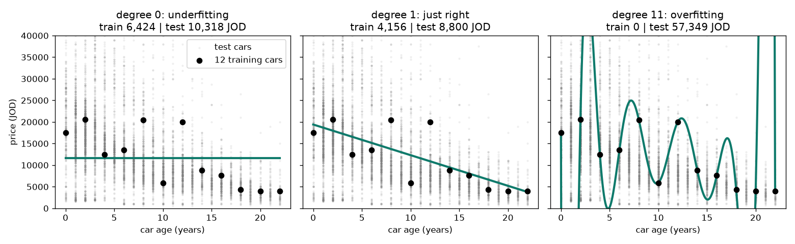
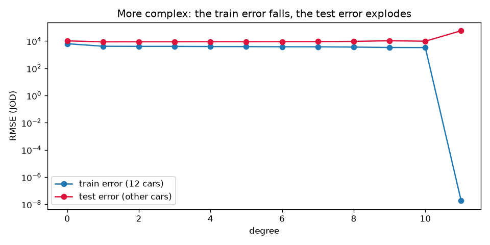
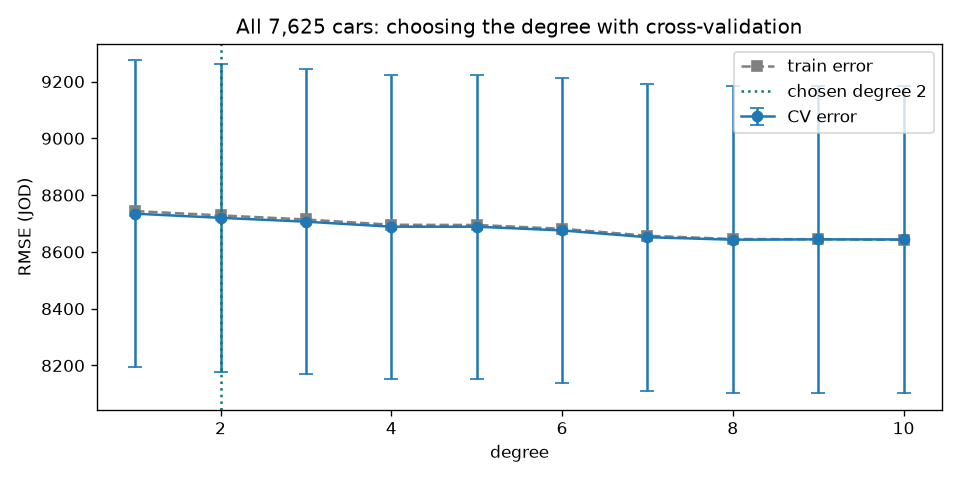
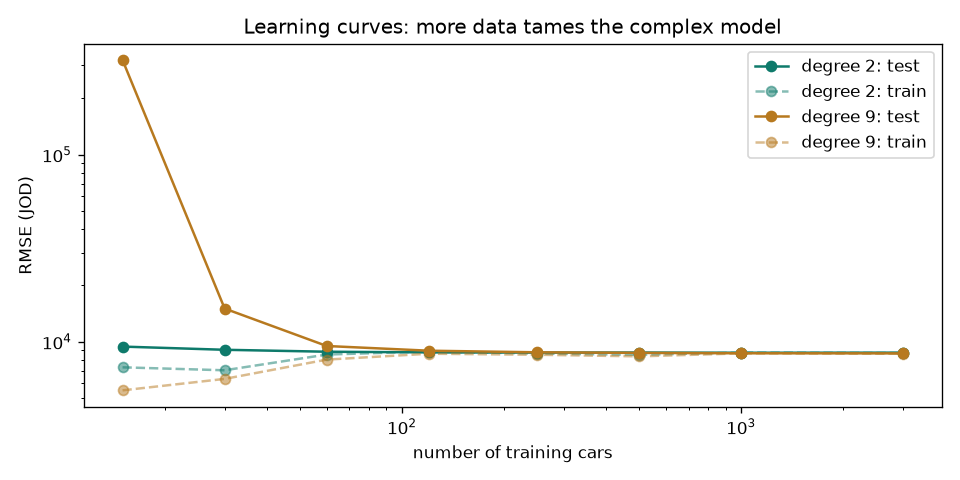

# Overfitting Lab

Polynomial regression written from scratch in NumPy, used to **watch a model memorize** used-car prices in Jordan,
and then to **choose the model's complexity honestly** with cross-validation and learning curves.

Polynomial regression is still linear regression: we add `x²`, `x³`, ... as new columns and learn one weight per column.
Ages are scaled to −1 … 1 first, because `x¹⁰` of an age of 20 is about 10 trillion.

## How to run

```powershell
python -m venv .venv
.venv\Scripts\activate
pip install -r requirements.txt
python main.py          # 3 experiments, prints tables, saves 4 charts
python -m pytest -v     # run the 8 tests
```

## Experiment 1: learn from 12 cars, test on 7,613 others

One random car for every even age (0, 2, …, 22). Error = RMSE in JOD.

| degree | train error | test error | |
|---|---|---|---|
| 0 | 6,424 | 10,318 | underfitting |
| **1** | 4,156 | **8,800** | best on the test cars |
| 3 | 4,075 | 8,896 | |
| 9 | 3,375 | 10,562 | |
| 11 | **0** | **57,349** | overfitting: passes through all 12 cars |

The train error always goes down; the test error does not.




## Experiment 2: all 7,625 cars, 5-fold cross-validation

| degree | train RMSE | CV RMSE |
|---|---|---|
| 1 | 8,744 | 8,735 ± 540 |
| 2 | 8,729 | 8,720 ± 542 |
| 8 | 8,645 | 8,643 ± 540 |
| 10 | 8,642 | 8,644 ± 541 |

With thousands of cars, even degree 10 does not overfit (train ≈ CV). The lowest CV error is degree 8,
but the whole difference (about 90 JOD) is much smaller than the spread between folds (± 540),
so I choose the **simplest degree within 1% of the best: degree 2**.



## Experiment 3: learning curves

Test RMSE, median of 30 random tries for each size.

| training cars | degree 2 | degree 9 |
|---|---|---|
| 15 | 9,426 | 320,341 |
| 60 | 8,849 | 9,494 |
| 250 | 8,755 | 8,786 |
| 3,000 | 8,746 | **8,670** |

The complex model is a disaster with little data and slightly better with a lot of data.
Below about 8,600 JOD nothing helps: that is noise that age alone cannot explain.



## Files

| file | what it does |
|---|---|
| `polylab.py` | polynomial columns, least-squares fit, k-fold CV by degree, learning curve, cleaning rule |
| `main.py` | the 3 experiments and the charts |
| `tests/test_polylab.py` | 8 tests (book example, exact interpolation, CV picks the true degree, ...) |

## Limitations

- Only one feature (age); the remaining error is mostly information the model does not have (make, model, condition).
- The 12-car experiment depends on which 12 cars are picked (seed 7); other picks give other numbers, same pattern.
- Cleaning: placeholder prices removed (price ≤ 1,500 and age ≤ 5), ages kept 0–22, prices ≤ 60,000.

## Data source

Jordan used-car listings, [Mendeley Data](https://data.mendeley.com/datasets/ddcz486x5t), licensed **CC BY 4.0**.
Taken from my [price-predictor](https://github.com/Mohdsuhail06/price-predictor) project.
